<!-- ============================ HEADER ============================ -->

  

<!-- logos only, intentionally not linked -->

  
  
  
  

<!-- ============================ ABOUT ============================ -->
<h2 align="center">👨‍💻 About Me</h2>

  

  
  
  

<!-- ============================ TECH STACK ============================ -->
<h2 align="center">🛠️ Tech Stack</h2>

<table align="center">
  <tr>
    <td align="center" width="170"><b>💻 Languages</b></td>
    <td>
      
      
    </td>
  </tr>
  <tr>
    <td align="center"><b>🎨 Frontend</b></td>
    <td>
      
      
      
      
      
      
      
      
    </td>
  </tr>
  <tr>
    <td align="center"><b>✨ Animation &amp; 3D</b></td>
    <td>
      
      
      
      
    </td>
  </tr>
  <tr>
    <td align="center"><b>⚙️ Backend &amp; DB</b></td>
    <td>
      
      
      
      
      
    </td>
  </tr>
  <tr>
    <td align="center"><b>🤖 AI / ML &amp; LLMs</b></td>
    <td>
      
      
      
      
      
      
      
      
      
    </td>
  </tr>
  <tr>
    <td align="center"><b>📊 Data &amp; Analytics</b></td>
    <td>
      
      
      
      
      
      
      
    </td>
  </tr>
  <tr>
    <td align="center"><b>🎥 Real-time</b></td>
    <td>
      
      
      
      
    </td>
  </tr>
  <tr>
    <td align="center"><b>🧰 Tools</b></td>
    <td>
      
      
      
    </td>
  </tr>
</table>

  <b>Concepts</b> 
  <code>EDA</code> <code>Data Visualization</code> <code>KPI Analysis</code> <code>RFM Analysis</code> <code>CLV</code> <code>Cohort Analysis</code> <code>Customer Segmentation</code> <code>Statistical Analysis</code> <code>Regression</code> <code>Supervised &amp; Unsupervised Learning</code> <code>Deep Learning</code> <code>Feature Engineering</code> <code>Data Modeling</code> <code>Data Cleaning</code> <code>RAG</code>

<!-- ============================ PROJECTS ============================ -->
<h2 align="center">🚀 Featured Projects</h2>

<table>
  <tr>
    <td width="50%" valign="top">
      <h3>📄 Hybrid ATS Resume Reviewer</h3>
      
Hybrid ATS reviewer for SDE &amp; Data Analyst roles with benchmark-based rankings. Regex keyword matching plus GenAI feedback via LangChain + Gemini, backed by FastAPI + NeonDB (Prisma) with OAuth.

      
      
      
      
      
      
    </td>
    <td width="50%" valign="top">
      <h3>🧠 Multimodal RAG Chatbot</h3>
      
PDF/image ingestion with Gemini Vision, OCR &amp; Pinecone embeddings. RAG flow with query rewriting, Groq responses and session-aware chat history for contextual follow-ups.

      
      
      
      
      
    </td>
  </tr>
  <tr>
    <td width="50%" valign="top">
      <h3>🏗️ Advanced SQL Data Warehouse</h3>
      
End-to-end warehouse on a Bronze → Silver → Gold architecture with a star schema, plus advanced SQL for customer segmentation, cohort analysis and performance reporting.

      
      
      
    </td>
    <td width="50%" valign="top">
      <h3>🍔 Swiggy Sales Analysis</h3>
      
<b>600K+</b> transactions · <b>10</b> cities · <b>7-page</b> Power BI dashboard. ETL pipelines, star schema and Python EDA to tackle retention &amp; revenue optimization.

      
      
      
    </td>
  </tr>
</table>

<!-- ============================ STATS ============================ -->
<h2 align="center">📊 GitHub Stats</h2>

  
  

  

  

<!-- ============================ FUN FACT ============================ -->
<h2 align="center">💬 Fun Fact</h2>

  

  

<!-- ============================ FOOTER ============================ -->

